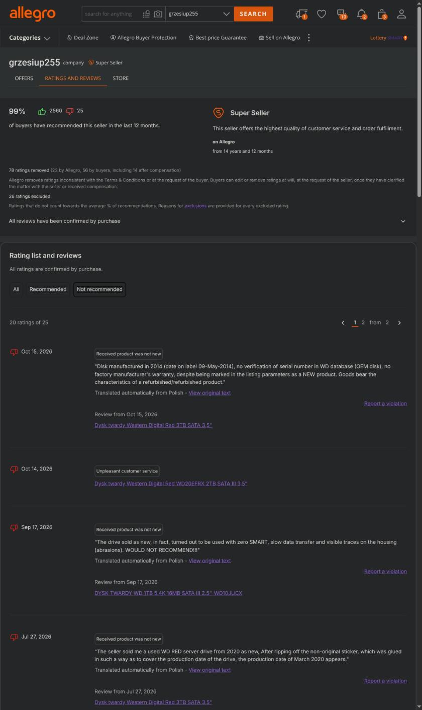
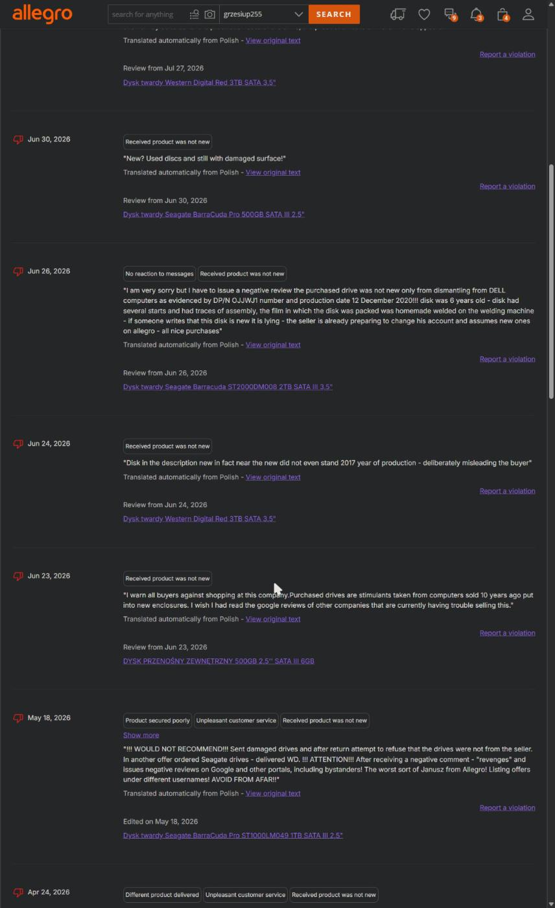
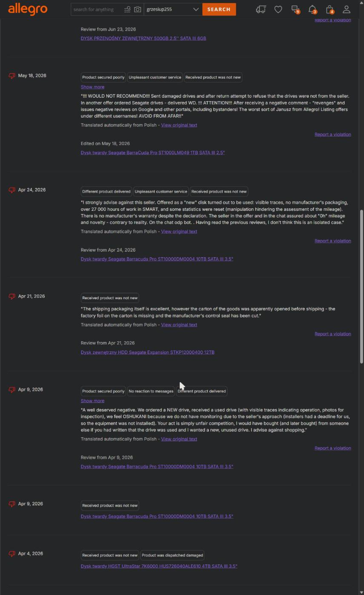

# Nieoryginalne „Samsung 870 EVO 2TB” sprzedane na Allegro jako nowe — dokumentacja sprawy

*English version below.*

To repozytorium zawiera pełną dokumentację reklamacji czterech dysków SSD sprzedanych na Allegro jako **nowe Samsung SSD 870 EVO 2 TB (MZ-77E2T0B/EU)**, które według pisemnej odpowiedzi oficjalnego serwisu producenta **nie są oryginalnymi dyskami Samsung**. Dane osobowe kupującego zostały usunięte (zaczernione na zrzutach, zastąpione `[Kupujący]` w tekstach). Wszystkie pozostałe dane — treść oferty, odczyty z dysków, zdjęcia etykiet, korespondencja — są publikowane bez zmian.

## Strony

| | |
|---|---|
| Sprzedawca | konto Allegro **grzesiup255**, nazwa handlowa **Kintech** — Grzegorz Pawlik, Mnichów 121a, 28-300 Jędrzejów, NIP 656-233-10-99, REGON 362036210 (dane z zakładki „O sprzedawcy” i CEIDG). CEIDG rejestruje ten NIP pod nazwami „1) GlobTronics Grzegorz Pawlik, 2) KINTECH Grzegorz Pawlik”, działalność główna 47.41.Z — sprzedaż detaliczna komputerów, od 15.07.2015. Ten sam podmiot (ten sam NIP, REGON, adres i telefon) prowadzi drugie konto Allegro **globtronics_PL** (zrzut: [`evidence/screens/2026-10-05_globtronics_PL-dane-firmy.jpg`](evidence/screens/2026-10-05_globtronics_PL-dane-firmy.jpg)) |
| Kupujący | konsument, Warszawa (dane usunięte) |
| Transakcja | zamówienie Allegro z 17.03.2025, oferta nr 16733065275, 4 × 675 zł = 2 700 zł |
| Oferta | „Dysk SSD Samsung MZ-77E2T0 2TB 2,5" SATA III 870 EVO” — Stan: **Nowy**, Producent: **Samsung**, kod producenta MZ-77E2T0B/EU, EAN 8806090545900, „gwarancja producenta 24 miesiące”; bez jakiejkolwiek informacji o nieoryginalności |
| Reklamacja Allegro | nr **3023695/2026**, złożona 02.10.2026, termin ustawowy odpowiedzi 16.10.2026 |
| Werdykt producenta | Samsung Memory Support (Hanaro Europe), zgłoszenie **431368**, 02.10.2026: *„We regret to inform you that all SSDs are not a genuine Samsung SSD.”* |

## Co wykazują dowody

1. **Etykiety** — wszystkie cztery dyski mają na etykiecie **ten sam WWN** `5002538F2000CAB` i **ten sam PSID** `YRR72JB0YU84ENPZP05K1AVSR2AJ1AWK`; różni je tylko numer seryjny. WWN i PSID są z definicji unikalne dla każdego egzemplarza. → [`evidence/photos/`](evidence/photos/)
2. **Kontroler** — każdy dysk w danych SMART READ DATA sam identyfikuje się jako `SMI2259XT` (Silicon Motion). Oryginalny 870 EVO ma kontroler Samsung MKX. → [`evidence/smart/smart-read-data_controller-id_extract.txt`](evidence/smart/smart-read-data_controller-id_extract.txt)
3. **Firmware** — dyski zgłaszają `W0814A0` (3 szt.) i `W0724A0` (1 szt.). Samsung publikuje dla 870 EVO wyłącznie wersje `SVT01B6Q`–`SVT04B6Q`.
4. **SMART** — 30 atrybutów w układzie Silicon Motion (m.in. 160–169, 245); oryginał zgłasza 14–15 atrybutów.
5. **Brak WWN** — IDENTIFY DEVICE, słowa 84/87 bit 8 = 0; oryginał zgłasza WWN z prefiksem Samsunga `5002538`.
6. **Standardy** — ACS-2 / SATA 3.2, brak deterministycznego TRIM, brak TCG Opal; oryginał: ACS-4 / SATA 3.3, TRIM „deterministic, zeroed”, AES/TCG Opal.
7. **Pojemność** — egzemplarz …077877 zgłasza 2 048 408 248 320 bajtów; oryginalny 2 TB ma 2 000 398 934 016.
8. **Wymiana na kolejny nieoryginalny** — dysk …077819 padł po kilku dniach (Dyskusja, kwiecień 2025); sprzedawca wymienił go na …077877, który ma tę samą etykietę (ten sam WWN/PSID) i ten sam typ kontrolera.

Szczegóły i odniesienia do specyfikacji producenta: [`docs/03-zalacznik-techniczny-PL.md`](docs/03-zalacznik-techniczny-PL.md) (EN: [`docs/04-technical-annex-EN.md`](docs/04-technical-annex-EN.md)).

## Jak sprawdzić własny dysk „870 EVO”

`smartctl -x /dev/sdX` (smartmontools). Oryginał: `Firmware Version: SVT0xB6Q`, wiersz `LU WWN Device Id: 5 002538 …`, `ATA Version is: ACS-4`, `SATA Version is: SATA 3.3`, 14–15 atrybutów SMART. Każde odstępstwo (firmware `W0…`, brak WWN, 30 atrybutów, ACS-2) oznacza, że to nie jest 870 EVO. Etykieta: WWN i PSID muszą być różne na każdym egzemplarzu.

## Chronologia

| Data | Zdarzenie |
|---|---|
| 17.03.2025 | zakup 4 szt. (2 700 zł), odbiór w paczkomacie |
| 14–17.04.2025 | dysk …077819 odłącza się losowo → Dyskusja → sprzedawca wymienia go na …077877 |
| 08.2026 | pierwsze odczyty SMART: trzy dyski mają realokowane sektory, ~13–14 TB zapisów na dysk |
| 01.10.2026 | pełne badanie `smartctl`: kontroler SMI2259XT, firmware W0814A0/W0724A0, brak WWN |
| 02.10.2026 11:57 | reklamacja Allegro nr 3023695/2026 (żądanie wymiany na oryginalne dyski) |
| 02.10.2026 12:09 | sprzedawca: „prosimy o odesłanie towaru” — bez odniesienia się do oryginalności |
| 02.10.2026 12:26 | Samsung Memory Support: *all SSDs are not a genuine Samsung SSD* |
| 02.10.2026 13:03 | konsultant Allegro: sprzedawca może oczekiwać najpierw udostępnienia towaru |
| 03.10.2026 15:51 | sprzedawca: zgoda na wydłużenie terminu do 12.10.2026, „towar musimy najpierw zweryfikować”; bez tak/nie co do oryginalności |
| 05.10.2026 11:28 | kupujący: dyski pozostają jako dowód do czasu porozumienia; trzy propozycje (wymiana jednoczesna / zwrot ceny + odszkodowanie / obniżenie ceny 80 %) |
| 05.10.2026 14:44 | sprzedawca odrzuca reklamację: „Buyer failed to return the goods” – bez odniesienia do stanowiska producenta |
| 05.10.2026 18:46 | sprzedawca: „nie odniosę się do stanowiska producenta, bo ja nawet nie mam pewności, czy to nasze dyski” |
| 06.10.2026 18:26 | sprzedawca: „Proszę o numer konta – zwrócę 80% wartości nośników” |
| 07.10.2026 14:21 | sprzedawca wycofuje ofertę: „**Pomyliłem klientów** tak samo jak Pan pomylił się w wyliczeniach zwrotów… Do zobaczenia na sali sądowej!” – oferta 80 % była dla innego klienta z tym samym problemem |
| 14.10.2026 06:57–07:01 | dyski wycofane z użycia: ostatnie pełne odczyty `smartctl -x` wszystkich czterech ([`evidence/smart/smartctl-x_2026-10-14_final_*.txt`](evidence/smart/)), stan puli ZFS i godzina ostatniego zapisu 07:01:42 CEST ([`zpool-status_2026-10-14_final.txt`](evidence/smart/zpool-status_2026-10-14_final.txt)); dane przeniesione na inny nośnik, dyski zachowane nienaruszone jako dowód (szyfrowanie ZFS, bez kasowania) |
| 16.10.2026 | termin ustawowy odpowiedzi na reklamację (art. 7a ustawy o prawach konsumenta) |

Pełny zapis czatu: [`docs/11-chat-allegro-PL-ES.md`](docs/11-chat-allegro-PL-ES.md) i [`evidence/screens/chat-reklamacja-3023695/`](evidence/screens/chat-reklamacja-3023695/).

## Też kupiłeś u tego sprzedawcy? Zgłoś się

Jeżeli kupiłeś u **grzesiup255 / Kintech** lub **globtronics_PL** dysk, który okazał się używany, nieoryginalny, z wyzerowanym SMART albo z nieoryginalną naklejką – Twoja relacja ma znaczenie. Prokuratura wszczyna postępowanie z art. 286 KK dopiero wtedy, gdy widzi powtarzalny schemat wobec wielu kupujących; pojedynczy przypadek traktuje jako „spór cywilny” i umarza. Na dzień 15.10.2026 konto grzesiup255 ma **25 opinii negatywnych** z ostatnich 12 miesięcy (w większości „produkt nie był nowy”) i 79 usuniętych, a sam sprzedawca napisał 7.10.2026 „pomyliłem klientów” – czyli prowadzi równolegle inne zwroty za ten sam problem.

**Kilka z tych opinii (zrzuty ze strony ocen sprzedawcy, Allegro tłumaczy je automatycznie):**







Pozostałe zrzuty: [`evidence/screens/opinie-sprzedawcy/`](evidence/screens/opinie-sprzedawcy/); pełna lista z tłumaczeniem: [`docs/14-opinie-sprzedawcy-ES.md`](docs/14-opinie-sprzedawcy-ES.md).

**Jak się zgłosić (bez podawania danych osobowych publicznie):** otwórz zgłoszenie w tym repozytorium → [Issues → New issue](https://github.com/akunito/kintech_fake/issues/new) i napisz: co kupiłeś, kiedy, co było nie tak, czy reklamowałeś i jak to się skończyło. Konto GitHub jest darmowe. Zgłoszenia zbieram do zawiadomienia o przestępstwie; dane kontaktowe wymienimy prywatnie. Jeśli wolisz anonimowo – wystarczy sam opis.

## Opinie innych kupujących

Na dzień 05.10.2026 konto miało 23 opinie negatywne (15.10.2026: 25) z ostatnich 12 miesięcy oraz **79 opinii usuniętych** (21 przez Allegro, 58 przez kupujących, 14 z nich „po otrzymaniu rekompensaty”). Według tych opinii (relacje kupujących, nie ustalenia własne): w 18 z 23 kupujący zaznaczyli „produkt nie był nowy”; powtarzają się: wyzerowane liczniki SMART, nieoryginalne naklejki, dysk z zapisanym cudzym systemem, kilka kont sprzedawcy, negatywna opinia w odpowiedzi na reklamację. → [`docs/14-opinie-sprzedawcy-ES.md`](docs/14-opinie-sprzedawcy-ES.md), zrzuty w [`evidence/screens/opinie-sprzedawcy/`](evidence/screens/opinie-sprzedawcy/).

## Zawartość

```
docs/
  01-reklamacja-PL.md            pismo reklamacyjne (PL, operatywne)
  02-claim-EN.md                 tłumaczenie na angielski
  03-zalacznik-techniczny-PL.md  analiza techniczna dysków (PL)
  04-technical-annex-EN.md       technical annex (EN)
  06-zalacznik-historia-PL.md    oferta z dnia zakupu, dane sprzedawcy, Dyskusja z kwietnia 2025
  08-email-to-samsung-EN.md      zapytanie do Samsung Memory Support
  11-chat-allegro-PL-ES.md       wszystkie wiadomości na czacie reklamacji (PL + ES)
  12-samsung-response-EN.md      odpowiedź producenta (zgłoszenie 431368)
  14-opinie-sprzedawcy-ES.md     23 opinie negatywne + wzorzec (ES)
evidence/
  photos/                        zdjęcia etykiet czterech dysków (02.10.2026)
  smart/                         surowe wyniki smartctl -x (01.10.2026 i końcowe 14.10.2026), IDENTIFY DEVICE (hex), SMART READ DATA (hex), zpool status
  screens/                       oferta archiwalna, Dyskusja 2025, reklamacja, czat, odpowiedź Samsung, ceny 2026, opinie
```

Dokumenty są publikowane w celach informacyjnych i dowodowych. Wszystkie twierdzenia techniczne można zweryfikować na podstawie surowych odczytów w `evidence/smart/`; ocena autentyczności pochodzi od producenta.

---

# Non-genuine "Samsung 870 EVO 2TB" sold as new on Allegro (Poland) — case file

Four SSDs sold on Allegro.pl as **new Samsung SSD 870 EVO 2TB (MZ-77E2T0B/EU)** by the business seller **grzesiup255 / Kintech** (Grzegorz Pawlik, Mnichów 121a, 28-300 Jędrzejów, NIP 656-233-10-99, REGON 362036210; the same NIP is registered in CEIDG as "GlobTronics Grzegorz Pawlik / KINTECH Grzegorz Pawlik", main activity retail of computers; the same entity also runs the Allegro account **globtronics_PL** — same NIP, REGON, address and phone, see `evidence/screens/2026-10-05_globtronics_PL-dane-firmy.jpg`). Samsung Memory Support (Hanaro Europe, ticket 431368, 2 Oct 2026) confirmed in writing: *"We regret to inform you that all SSDs are not a genuine Samsung SSD."* The buyer's personal data has been removed; everything else is published unchanged.

## Did you also buy from this seller? Please come forward

If you bought a drive from **grzesiup255 / Kintech** or **globtronics_PL** that turned out used, non-genuine, with reset SMART counters or a non-original sticker, your account matters: the prosecutor opens a case under art. 286 KK only when a repeated pattern across several buyers is shown; a single case is treated as a "civil dispute" and dropped. As of 15 Oct 2026 the account has **25 negative ratings** in 12 months and 79 removed ones, and the seller himself wrote on 7 Oct 2026 "I mixed up the clients" — he is handling other refund claims for the same problem.

Some of those ratings (screenshots of the seller's rating page): [15 Oct + 27 Jul 2026 — "new" drive made in 2014, no warranty; non-original sticker glued over the production date](evidence/screens/opinie-sprzedawcy/2026-10-16_opinie-negatywne_nowe-01.jpg) · [June–May 2026 — drives pulled from DELL PCs sold as new; "the seller is preparing to switch accounts"; denied the returned drives were his; retaliates with Google reviews; lists under different usernames](evidence/screens/opinie-sprzedawcy/2026-10-05_opinie-negatywne_02.jpg) · [24 Apr 2026 — 27,000 h drive with reset SMART sold as new, no manufacturer warranty](evidence/screens/opinie-sprzedawcy/2026-10-05_opinie-negatywne_03.jpg).

**How:** open an issue in this repository → [Issues → New issue](https://github.com/akunito/kintech_fake/issues/new): what you bought, when, what was wrong, whether you complained and how it ended. No personal data needed in public; contact details are exchanged privately. Polish, English or Spanish.

**Evidence in brief**

- All four labels carry the **same WWN** `5002538F2000CAB` and the **same PSID** `YRR72JB0YU84ENPZP05K1AVSR2AJ1AWK` — both are unique per unit on genuine drives ([`evidence/photos/`](evidence/photos/)).
- Each drive self-identifies its controller as **`SMI2259XT`** (Silicon Motion) in SMART READ DATA; a real 870 EVO uses Samsung MKX ([extract](evidence/smart/smart-read-data_controller-id_extract.txt)).
- Firmware `W0814A0` / `W0724A0` — Samsung ships only `SVT01B6Q`–`SVT04B6Q`.
- 30 SMART attributes in Silicon Motion layout (genuine: 14–15); no WWN in IDENTIFY DEVICE; ACS-2 / SATA 3.2; no deterministic TRIM, no TCG Opal; one unit reports 2,048,408,248,320 bytes instead of 2,000,398,934,016.
- The unit that failed after three days in April 2025 was **replaced with another non-genuine unit** bearing the same label data.
- Listing at the time of purchase: condition *New*, manufacturer *Samsung*, EAN 8806090545900, "24-month manufacturer warranty", no disclosure of any kind.
- Seller's feedback: 23 negatives in 12 months and 79 removed ratings; according to those buyers, 18/23 say "the product was not new" (reset SMART counters, non-original stickers, drives with someone else's OS, negative ratings posted back at complaining buyers).

**Verify your own "870 EVO"**: `smartctl -x /dev/sdX` — genuine drives report `Firmware Version: SVT0xB6Q`, an `LU WWN Device Id: 5 002538 …` line, `ACS-4`, `SATA 3.3` and 14–15 SMART attributes.

**Status**: Allegro complaint 3023695/2026 filed 2 Oct 2026 and rejected by the seller on 5 Oct ("buyer failed to return the goods" — no word on authenticity; "I will not address the manufacturer's position, I am not even sure these are our drives"). On 6 Oct the seller offered to refund 80 %; on 7 Oct he withdrew it: "**I mixed up the clients** … see you in court!" — i.e. at least one other customer has a refund claim for the same product. Criminal report and consumer-authority complaints in preparation. Full claim in English: [`docs/02-claim-EN.md`](docs/02-claim-EN.md); technical annex: [`docs/04-technical-annex-EN.md`](docs/04-technical-annex-EN.md).

**Drives retired as evidence (14 Oct 2026)**: the ZFS pool was migrated off the four drives; a final `smartctl -x` of each ([`evidence/smart/smartctl-x_2026-10-14_final_*.txt`](evidence/smart/)) and the pool status with the export time, 07:01:42 CEST, the last write to them ([`zpool-status_2026-10-14_final.txt`](evidence/smart/zpool-status_2026-10-14_final.txt)), were taken just before removal. After roughly 10,000 power-on hours and ~200 TB written per drive, three of the four report reallocated sectors (3, 4 and 6). The drives are kept powered off and unaltered (ZFS-encrypted, not wiped) for an independent expert or the authorities.

Published for information and as evidence. Every technical claim can be checked against the raw dumps in `evidence/smart/`; the authenticity verdict is the manufacturer's.
